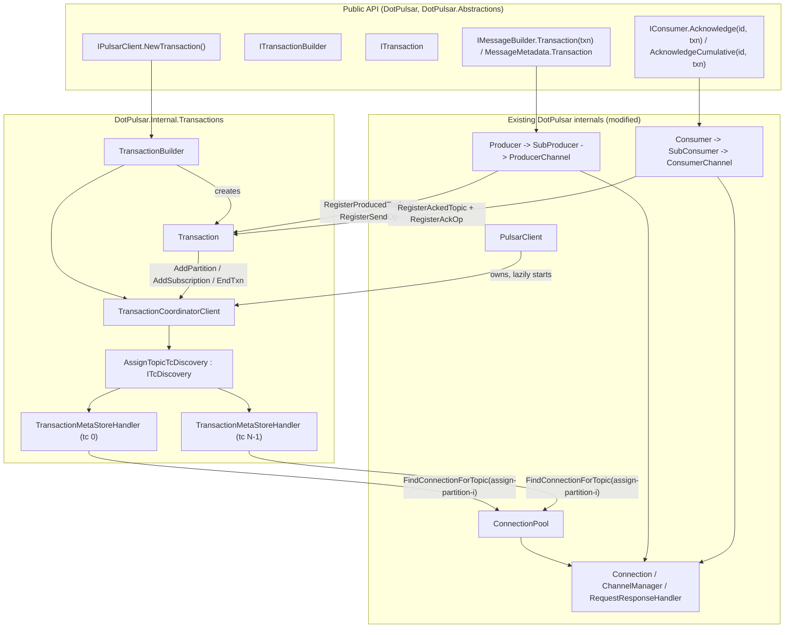
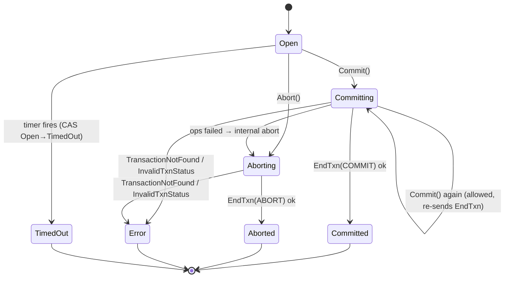
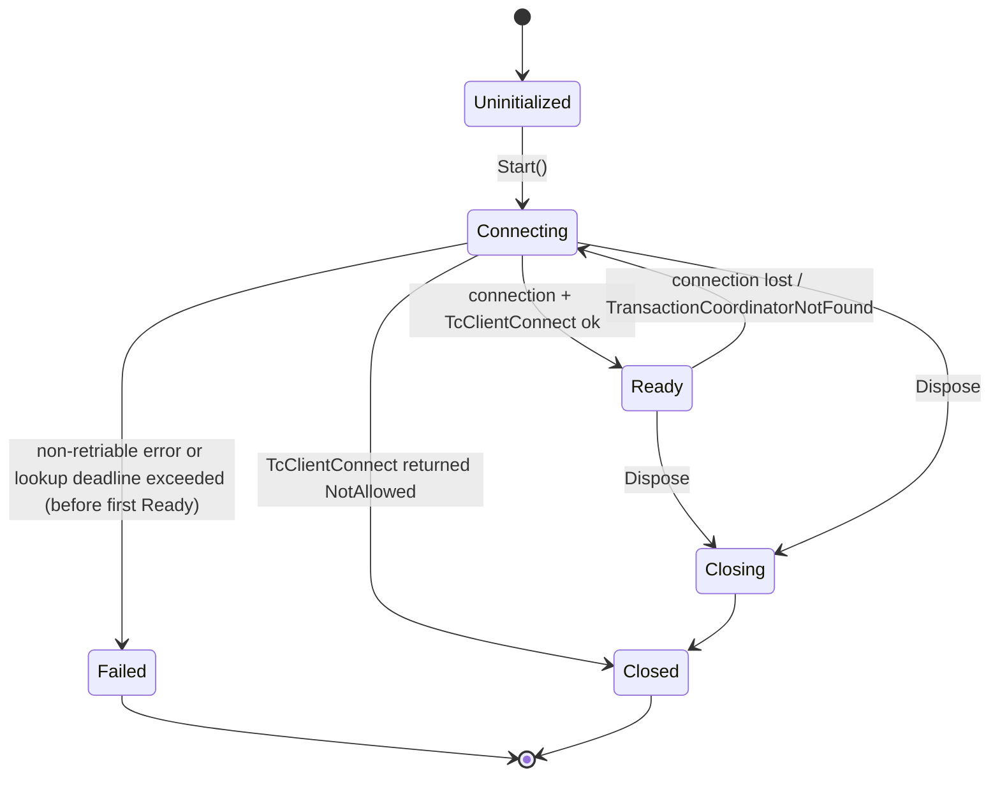

# 02 — Architecture

## 1. Component overview



## 2. Upstream → C# component map

| Java (pinned) | C# type | File | Spec |
|---|---|---|---|
| `TxnID` | `TransactionId` (readonly struct) | `src/DotPulsar/TransactionId.cs` | [05/transaction-id](05-components/transaction-id.md) |
| `Transaction.State` | `TransactionState` (enum : byte) | `src/DotPulsar/TransactionState.cs` | [03](03-public-api.md) |
| `Transaction` | `ITransaction` | `src/DotPulsar/Abstractions/ITransaction.cs` | [03](03-public-api.md) |
| `TransactionBuilder` | `ITransactionBuilder` | `src/DotPulsar/Abstractions/ITransactionBuilder.cs` | [03](03-public-api.md) |
| `TransactionImpl` | `Transaction` | `src/DotPulsar/Internal/Transactions/Transaction.cs` | [05/transaction](05-components/transaction.md) |
| `TransactionBuilderImpl` | `TransactionBuilder` | `src/DotPulsar/Internal/TransactionBuilder.cs` (next to `ProducerBuilder.cs`) | [05/transaction-builder](05-components/transaction-builder.md) |
| `TransactionCoordinatorClient` (+Impl) | `ITransactionCoordinatorClient` + `TransactionCoordinatorClient` | `Internal/Abstractions/ITransactionCoordinatorClient.cs`, `Internal/Transactions/TransactionCoordinatorClient.cs` | [05/transaction-coordinator-client](05-components/transaction-coordinator-client.md) |
| `TransactionCoordinatorClient.State` | `TransactionCoordinatorClientState` | `Internal/Transactions/TransactionCoordinatorClientState.cs` | same |
| `TcDiscovery` | `ITcDiscovery` | `Internal/Abstractions/ITcDiscovery.cs` | [05/assign-topic-tc-discovery](05-components/assign-topic-tc-discovery.md) |
| `AssignTopicTcDiscovery` | `AssignTopicTcDiscovery` | `Internal/Transactions/AssignTopicTcDiscovery.cs` | same |
| `TransactionMetaStoreHandler` | `TransactionMetaStoreHandler` (+ `ITransactionMetaStoreHandler`) | `Internal/Transactions/TransactionMetaStoreHandler.cs`, `Internal/Abstractions/ITransactionMetaStoreHandler.cs` | [05/transaction-meta-store-handler](05-components/transaction-meta-store-handler.md) |
| `HandlerState.State` (subset) | `TransactionMetaStoreHandlerState` | `Internal/Transactions/TransactionMetaStoreHandlerState.cs` | same |
| `ClientCnx` txn parts | `Connection`, `ChannelManager`, `RequestResponseHandler`, `CommandExtensions` | existing | [05/connection-integration](05-components/connection-integration.md) |
| `ProducerBase/ProducerImpl/PartitionedProducerImpl/TypedMessageBuilderImpl` txn parts | `MessageBuilder`, `MessageMetadata`, `Producer`, `SubProducer`, `SendOp`, `ProducerChannel`, `ProducerChannelFactory` | existing | [05/producer-integration](05-components/producer-integration.md) |
| `ConsumerBase/ConsumerImpl/MultiTopicsConsumerImpl` txn parts | `Consumer`, `SubConsumer`, `ConsumerChannel`, `ConsumerExtensions` | existing | [05/consumer-integration](05-components/consumer-integration.md) |
| `PulsarClientImpl`/`ClientBuilderImpl`/`ClientConfigurationData` txn parts | `PulsarClient`, `PulsarClientBuilder` | existing | [05/client-integration](05-components/client-integration.md) |
| `TransactionCoordinatorClientException` & friends | exceptions | `src/DotPulsar/Exceptions/*` | [05/exceptions](05-components/exceptions.md) |

## 3. Ownership and lifetime

```
PulsarClient                                   (owns; disposes before ConnectionPool)
 └─ TransactionCoordinatorClient?              (created in PulsarClient ctor iff EnableTransaction(true); started lazily)
     └─ AssignTopicTcDiscovery                 (created by Start)
         └─ TransactionMetaStoreHandler[N]     (one per TC; each owns its reconnect loop + pending-op table + timeout timer)
             └─ IConnection                    (borrowed from ConnectionPool; registered with ChannelManager to stay Active)
Transaction                                    (owned by user; holds ref to ITransactionCoordinatorClient; owns Timer)
```

**Disposal order in `PulsarClient.DisposeAsync`** (Java `PulsarClientImpl#closeAsync`, `tcClient.closeAsync()` L1491-1498):
1. Dispose producers, consumers and readers (existing behaviour).
2. Dispose the `TransactionCoordinatorClient`. Its state goes `Closing` → `Closed`; each handler is disposed and
   fails its pending ops with `PulsarClientClosedException`
   (Java: `AlreadyClosedException("Could not get response from transaction meta store when the transaction meta store has already close.")`;
   see [05/exceptions](05-components/exceptions.md) for the C# mapping).
3. Dispose the `ConnectionPool` (existing).

Transactions that are still open when the client is disposed are **not** aborted by the client. The broker times them
out, as in Java. Their `Commit`/`Abort` then fail with `TransactionCoordinatorClientStateException`
(`TransactionClientCloseTest#testEndTransactionAfterClientClose`), because the TC client is no longer `Ready`.

## 4. Start-up (decision: lazy, shared, retryable)

Java starts the TC client synchronously inside the `PulsarClientImpl` constructor, so `ClientBuilder.build()` fails when
no TC is reachable. DotPulsar's `IPulsarClientBuilder.Build()` is synchronous and never does I/O. To keep that contract
([ADR 0008](decisions/0008-lazy-transaction-coordinator-start.md)):

- `PulsarClientBuilder.Build()` creates a `TransactionCoordinatorClient` (state `None`) when `EnableTransaction(true)`
  was set, and passes it to `PulsarClient`.
- The first `ITransactionBuilder.Create(ct)` awaits `TransactionCoordinatorClient.Start(ct)`, which is idempotent.
  Concurrent callers share one start `Task`.
- If start fails, the shared task is cleared and the state returns to `None`. The exception (for example
  `TransactionCoordinatorNotFoundException` "The broker doesn't enable the transaction coordinator, or the transaction
  coordinator has not initialized") propagates to every waiting `Create`. The next `Create` retries start.
- Calling `Start` again once the state is `Ready` returns immediately. (Java's `start()` throws in that case; that only
  matters to callers of the internal API. The internal `Start` keeps Java's state check, and the idempotence lives in
  the `EnsureStarted` wrapper. See [05/transaction-coordinator-client](05-components/transaction-coordinator-client.md).)

Test impact: `TransactionClientConnectTest#testNotEnableTransactionInBroker` asserts that `build()` throws. The port
asserts that the **first `NewTransaction().Create()`** throws ([08-test-parity](08-test-parity.md) records this
substitution).

## 5. Data flows

### 5.1 New transaction

```mermaid
sequenceDiagram
    participant App
    participant TB as TransactionBuilder
    participant TCC as TransactionCoordinatorClient
    participant D as AssignTopicTcDiscovery
    participant H as MetaStoreHandler[i]
    participant B as Broker (TC i)
    App->>TB: NewTransaction().Timeout(t).Create(ct)
    TB->>TCC: EnsureStarted(ct)
    TCC->>D: Start (first time only): GetNumberOfPartitions(assign) → N; N handlers connect (TcClientConnectRequest)
    TB->>TCC: NewTransaction(t, ct)
    TCC->>D: NextHandler() (round-robin, starts at index 1)
    TCC->>H: NewTransaction(t, ct)
    H->>B: CommandNewTxn{request_id, txn_ttl_millis=t, tc_id=i}
    B-->>H: CommandNewTxnResponse{txnid_most_bits=i, txnid_least_bits=k}
    H-->>TB: TransactionId(i, k)
    TB-->>App: new Transaction(tcClient, id, t) (state Open, timer armed)
```

**Wire detail.** DotPulsar's proto names field 2 of `CommandNewTxn` `txn_ttl_seconds`, but the value has always been **milliseconds**. Upstream renamed it to `txn_ttl_millis`. WP1 renames the field the same way; the field number and wire format do not change. Assign `TxnTtlMillis = (ulong) timeout.TotalMilliseconds`. See [connection-integration §0](05-components/connection-integration.md).

### 5.2 Transactional produce

1. `producer.NewMessage().Transaction(txn).Send(value, ct)` sets `MessageMetadata.Transaction = txn`.
2. `Producer.InternalSend` checks that `txn.CurrentState == Open`; otherwise it throws `InvalidTransactionStatusException`
   (Java `ProducerImpl#internalSendWithTxnAsync` L519-530, `PartitionedProducerImpl#internalSendWithTxnAsync` L256-314).
3. It routes to the partition `subProducer`.
4. `await txn.RegisterProducedTopic(subProducer.Topic, ct)`. On the first call for a given partition this sends
   `CommandAddPartitionToTxn`. After that it is a cached completed task, with no allocation (see [07](07-performance.md)).
5. `txn.RegisterSendOp(receiptTask)` (Java `TypedMessageBuilderImpl#sendAsync` L131-141).
6. `ProducerChannel.Send` copies `TxnidMostBits` / `TxnidLeastBits` onto both `MessageMetadata` (fields 22/23) and
   `CommandSend` (fields 4/5), and resets them on the pooled `SendPackage` (`Commands#newSend` L596-650).
7. Batching ([06/producer-batching](06-prerequisites/producer-batching.md)) never mixes transactions in one batch
   (`BatchMessageContainerImpl#hasSameTxn`).

### 5.3 Transactional acknowledge

1. `consumer.Acknowledge(messageId, txn, ct)` checks that `txn` is an internal `Transaction`; otherwise it throws
   `ArgumentException`, matching Java's `IllegalArgumentException` at `ConsumerBase` L687-707. If the transaction is
   not `Open`, it throws `InvalidTransactionStatusException`.
2. It routes to the `SubConsumer` for `messageId.Topic`.
3. `await txn.RegisterAckedTopic(subConsumer.Topic, subscriptionName, ct)`, which sends `CommandAddSubscriptionToTxn`
   once per (partition, subscription).
4. `SubConsumer` builds a `CommandAck` with `TxnidMostBits` / `TxnidLeastBits` and `RequestId` (assigned by
   `RequestResponseHandler`). For batch messages it also sets `ack_set` and `batch_size`
   (`ConsumerImpl#doTransactionAcknowledgeForResponse` L3520-3585). It then awaits `CommandAckResponse`; an error maps
   through `CommandExtensions.Throw`.
5. `txn.RegisterAckOp(ackTask)`.
6. Cumulative transactional acks are rejected on `Shared`/`KeyShared` subscriptions with `ConfigurationException`
   ("Cannot use cumulative acks on a non-exclusive/non-failover subscription"; Java `ConsumerBase` L715-735).

### 5.4 Commit / abort

See [05/transaction §Commit](05-components/transaction.md). Commit waits for every registered op. If any op failed, it
aborts and throws `TransactionHasOperationFailedException`. Otherwise `TCC.Commit(id)` sends `CommandEndTxn{COMMIT}` to
handler `id.MostSigBits`, and the state becomes `Committed`. If the TC answers `TransactionNotFound` or
`InvalidTxnStatus`, the state becomes `Error`.

## 6. State machines

### 6.1 Transaction (`TransactionState`, Java `Transaction.State`)



Other errors (timeout, coordinator unavailable) fail the `Commit`/`Abort` task **without** changing the state, so it
stays `Committing`/`Aborting`. The user may then call `Commit()`/`Abort()` again, because `checkState` allows
`Committing` for commit and `Aborting` for abort.

### 6.2 TC client (`TransactionCoordinatorClientState`, Java `TransactionCoordinatorClient.State`)

`None → Starting → Ready → Closing → Closed`. On a failed start: `Starting → None` (C#-specific, so that start can be
retried; see §4).

### 6.3 Meta-store handler (`TransactionMetaStoreHandlerState`, Java `HandlerState.State` subset)



## 7. Threading model

- **No dedicated threads or executors.** Java pins handler work to an event-loop executor. DotPulsar serialises the
  equivalent state with Interlocked/CAS and short `lock` sections. All I/O is async.
- `Transaction`: `_state` is an `int` updated with `Interlocked.CompareExchange`, following Java's
  `AtomicReferenceFieldUpdater`. `_opCount` is a `long` updated with `Interlocked.Increment`/`Decrement`.
  `_hasOpsFailed` is a `volatile bool`. Registration maps are `ConcurrentDictionary`, and the miss path takes a lock
  so that one TC request is sent per key, matching Java's atomic `ConcurrentHashMap.compute`.
- `TransactionMetaStoreHandler`: the pending ops live in a `ConcurrentDictionary<ulong /*opId*/, Op>`. A periodic
  timer sweeps timeouts. The connection-loop task is the only writer of `_connection` and the state. A
  `SemaphoreSlim(1000)` limits outstanding ops; it is awaited **asynchronously** (C# deviation from Java's blocking
  `acquire`, recorded in [12](12-risks-open-questions.md)).
- Continuations always run asynchronously (`RunContinuationsAsynchronously`), so no user code ever runs while a
  DotPulsar lock is held.

## 8. Reconnect

Each handler runs one long-lived loop. It looks up the connection for its assign-partition topic, sends
`CommandTcClientConnectRequest`, registers with the connection's `ChannelManager` (so the connection stays `Active`
and is not closed as idle), switches to `Ready` and resends every pending op. It then awaits
`connection.State.OnStateChangeFrom(ConnectionState.Connected)`, switches to `Connecting`, and loops with exponential
backoff (100 ms → 60 s, Java `TransactionMetaStoreHandler` ctor L140-148). Each pending op has its own retry backoff
(100 ms → 6 s) for `TransactionCoordinatorNotFound` responses. Ops are bounded by the operation timeout (30 s) enforced
by the sweep. Full detail is in [05/transaction-meta-store-handler](05-components/transaction-meta-store-handler.md).

## 9. Configuration surface (all new)

| Setting | Where | Default | Java |
|---|---|---|---|
| `EnableTransaction(bool)` | `IPulsarClientBuilder` | `false` | `ClientBuilder.enableTransaction` (default false, `ClientConfigurationData` L475) |
| `OperationTimeout(TimeSpan)` | `IPulsarClientBuilder` | 30 s | `operationTimeoutMs` 30000 (L138); used for TC ops, ack receipts and lookups by TC handlers |
| `Timeout(TimeSpan)` | `ITransactionBuilder` | 60 s | `TransactionBuilderImpl` default 60000 ms |

Prerequisite features add producer and consumer options; see [06-prerequisites](06-prerequisites/).
