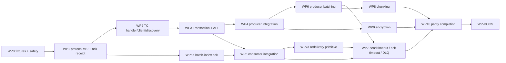

# 10 — Implementation plan (work packages)

Implement in this order. Each WP is one PR targeting `master`, preceded by a tracking issue (CONTRIBUTING requires
an issue before large PRs). A WP may not start before its dependencies are merged, or are at least stacked on the
same branch. Each WP must leave `master` green: all existing tests pass, and new features are off by default.

**Branch naming:** `transactions/wpN-<slug>`. **Commit/PR format:** [01-conventions §10](01-conventions.md#10-commits-prs-changelog-docs).
Update `upstream-map.yaml` statuses in every WP.

## Common verification commands

```bash
dotnet build DotPulsar.sln -c Release                                   # must be warning-free for new code, all TFMs
dotnet test tests/DotPulsar.Tests/DotPulsar.Tests.csproj --filter "Category=Unit"
dotnet test tests/DotPulsar.Tests/DotPulsar.Tests.csproj --filter "Category=Integration"   # needs Docker
dotnet test tests/DotPulsar.Tests/DotPulsar.Tests.csproj --filter "FullyQualifiedName~DotPulsar.Tests.Transactions"
dotnet run -c Release --project benchmarks/Transactions -- --filter "*"  # from WP4 onwards
```

## Dependency graph



---

## WP0 — Test infrastructure and response-type safety

**Goal.** Build the test infrastructure, and make unknown response types harmless so that no later step can kill a
connection (hazard 1).

**Changes.**
1. `tests/DotPulsar.Tests/TransactionFixture.cs`, `TransactionCollection.cs`,
   `TransactionWithoutBatchIndexAckFixture.cs` (+ collection), and the helpers listed in
   [09-test-infrastructure](09-test-infrastructure.md).
2. `RequestResponseHandler.Incoming`: an unregistered response type is ignored, with no throw. Today the
   `EnumLookup` default throws `Exception("CommandType ... not supported as request/response type")`, and
   `Connection.ProcessIncomingFrames` swallows it and ends the read loop. Leave the default throwing for programmer
   errors in outgoing registration only; an **incoming** command with no handler is dropped. Add a regression test.
3. A smoke integration test: `TransactionFixture_ShouldHaveTransactionCoordinatorAssignTopic`. Through the admin
   helper, `persistent://pulsar/system/transaction_coordinator_assign` has ≥ 1 partition.

**Acceptance.** Both fixtures start in CI. The smoke test passes. The existing suite still passes.

## WP1 — Protocol v19, TC command plumbing, ack receipt

**Depends on** WP0. **Specs:** [04-protocol](04-protocol.md), [05/connection-integration](05-components/connection-integration.md), [06/ack-receipt](06-prerequisites/ack-receipt.md), [05/exceptions](05-components/exceptions.md) §4.1/§6.

**Changes.**
1. `Constants.ProtocolVersion = 19`, plus every item on the [04-protocol](04-protocol.md) regression checklist
   (e.g. broker entry metadata parsing).
2. `CommandExtensions`:
   - `AsBaseCommand` for `CommandNewTxn`, `CommandAddPartitionToTxn`, `CommandAddSubscriptionToTxn`, `CommandEndTxn`
     and `CommandTcClientConnectRequest`;
   - `Throw` overloads for the responses;
   - the `TransactionNotFound` mapping.
3. `RequestResponseHandler`: an `Outgoing` overload plus a `_getResponseIdentifier` registration for every
   TC response and for `AckResponse`.
4. `ChannelManager`: pass-throughs, and `Register`/`UnregisterTransactionMetaStoreHandler`, so that a connection
   with handlers counts as Active (hazard 3).
5. `IConnection`/`Connection`: the new `Send` overloads, the `CommandAck` request variant, and the handler
   registration.
6. Ack receipt ([06/ack-receipt](06-prerequisites/ack-receipt.md)): `ConsumerOptions.AckReceiptEnabled` / builder;
   acks carry `request_id` and await `CommandAckResponse`.
7. New exceptions: `TransactionNotFoundException` and `OperationTimeoutException`.
8. `IPulsarClientBuilder.OperationTimeout`.

**Acceptance.**
- Unit tests for each new `Send` and its registration.
- The ack-receipt unit and integration tests from the ack-receipt spec.
- The full existing suite passes on v19.
- The protocol checklist tests pass.

## WP2 — TC client, discovery, meta-store handler

**Depends on** WP1. **Specs:** [05/transaction-meta-store-handler](05-components/transaction-meta-store-handler.md), [05/assign-topic-tc-discovery](05-components/assign-topic-tc-discovery.md), [05/transaction-coordinator-client](05-components/transaction-coordinator-client.md).

**Changes.**
- `Internal/Backoff.cs`
- `Internal/RetriableErrors.cs`
- `ITransactionMetaStoreHandler`, `TransactionMetaStoreHandler`, `TransactionMetaStoreHandlerState`, `TransactionMetaStoreOp`
- `ITcDiscovery`, `AssignTopicTcDiscovery`
- `ITransactionCoordinatorClient`, `TransactionCoordinatorClient`, `TransactionCoordinatorClientState`
- The exceptions `TransactionCoordinatorClientException`, `TransactionCoordinatorClientStateException`,
  `MetaStoreHandlerNotExistsException` and `MetaStoreHandlerNotReadyException`

**Tests.**
- All unit tests in those three specs.
- The `TransactionMetaStoreHandlerTest`, `TransactionCoordinatorClientTest`, `TransactionClientCloseTest` and
  `TransactionClientConnectTest` rows of [08](08-test-parity.md).
- One integration test: the TC client starts against `TransactionFixture`, then runs new, commit and abort by id.

**Acceptance.** Every listed test passes. Disposal leaves no pending tasks: the tests await `DisposeAsync` and assert
`PendingRequestsCount == 0` and `AvailableRequestPermits == 1000`.

## WP3 — Transaction, builder, client API

**Depends on** WP2. **Specs:** [03-public-api](03-public-api.md), [05/transaction](05-components/transaction.md), [05/transaction-builder](05-components/transaction-builder.md), [05/client-integration](05-components/client-integration.md), [05/transaction-id](05-components/transaction-id.md).

**Changes.**
- New types: `TransactionId`, `TransactionState`, `TransactionOptions`, `ITransaction`, `ITransactionBuilder`,
  `TransactionBuilder`, `Transaction`, `TransactionHasOperationFailedException`.
- `IPulsarClient.CreateTransaction`; `PulsarClient` holds the TC client, starts it lazily and disposes it.
- `PulsarClientExtensions.NewTransaction`.
- `IPulsarClientBuilder.EnableTransaction`.

**Tests.** The unit tests in those specs; `TransactionBuilderTest` parity; and integration tests for create, commit
and abort of empty transactions, plus timeout to `TimedOut`.

## WP4 — Producer integration

**Depends on** WP3. **Spec:** [05/producer-integration](05-components/producer-integration.md).

**Changes.**
- `MessageMetadata.Transaction`, `IMessageBuilder.Transaction`, `MessageBuilder`.
- `MessageMetadataObjectPool` reset.
- `Producer` (open check, `RegisterProducedTopic`, `RegisterSendOp`), `SendOp`.
- `ProducerChannel` (txnid on CommandSend + metadata, with the pooled reset).
- `ProducerChannelFactory` (`TxnEnabled`).
- Per-message `SendError` failure, so a send error does not fault the producer (hazard 5).
- The `benchmarks/Transactions` project with `SendBenchmarks`.

**Tests.** Producer unit tests including the pool-reset regression; the produce-only parity tests
(`produceCommitTest` with the batch=false variant, `produceAbortTest`, `produceTxnMessageOrderTest` (non-batch),
`testTxnTimeOutInClient` send part, `testDelayedDeliveryExceedsMaxDelay`, …). The batch=true variants are
**skipped** until WP6, with `Skip = "Requires producer batching (WP6)"` and TODO markers. WP6 removes those skips.

**Acceptance.** Benchmark P1/P2 thresholds for send.

## WP5a — Batch-index acknowledgment

**Depends on** WP1. **Spec:** [06/batch-index-ack](06-prerequisites/batch-index-ack.md). Fixes hazard 6 for
transactional acks, and optionally for plain acks.

## WP5 — Consumer integration

**Depends on** WP3 and WP5a. **Spec:** [05/consumer-integration](05-components/consumer-integration.md).

**Changes.**
- `IConsumer` overloads, `Consumer`, `SubConsumer`, `ConsumerChannel`, `ConsumerExtensions`, and the pooled
  `CommandAck` reset.
- The cumulative-ack subscription-type check.
- `AckBenchmarks` and `AckSetBenchmarks`.

**Tests.** All parity tests that need only consumer txn + ack receipt + batch-index ack (non-batch producer
variants).

## WP6 — Producer batching

**Depends on** WP4. **Spec:** [06/producer-batching](06-prerequisites/producer-batching.md).

Remove the WP4/WP5 skips for batch variants; they must pass. Port `BatchMessageContainerImplTest`.

## WP7a — Redelivery primitive

**Depends on** WP5. **Spec:** [06/ack-timeout §redelivery primitive](06-prerequisites/ack-timeout.md).

Per-id redelivery semantics, epoch handling and purging of the prefetch queue, shipped on their own. `txnCumulativeAckTest` needs these even without ack timeout. This WP includes the public behaviour changes listed in [06 README §6](06-prerequisites/README.md).

## WP7 — Send timeout, ack timeout, dead-letter policy

**Depends on** WP5 and WP6. **Specs:** [06/send-timeout](06-prerequisites/send-timeout.md),
[06/ack-timeout](06-prerequisites/ack-timeout.md), [06/dead-letter-policy](06-prerequisites/dead-letter-policy.md).

**Depends on** WP7a as well. Enables `testSendTxnAckMessageToDLQ`, `testSendTxnAckBatchMessageToDLQ` and the ack-timeout variants.

## WP8 — Chunking

**Depends on** WP6 (chunking is mutually exclusive with batching). **Spec:** [06/chunking](06-prerequisites/chunking.md).
Enables `TransactionConsumeTest#testAckChunkMessage`.

## WP9 — End-to-end encryption

**Depends on** WP4. **Spec:** [06/encryption](06-prerequisites/encryption.md). Enables `TransactionTest#testEncryptionRequired`.
This WP is the largest and has the lowest priority.

## WP10 — Parity completion and hardening

Close the matrix: every row in [08](08-test-parity.md) is ported or explicitly excluded.

- Run the integration suite 20 times in a loop to detect flakiness:
  `for i in $(seq 20); do dotnet test --filter "FullyQualifiedName~Transactions" || break; done`
- Fix any race the loop surfaces.
- Update `upstream-map.yaml` so that every status is final.

## WP-DOCS — Documentation and release notes

- **`CHANGELOG.md`:** an `[Unreleased]` section with all entries from [03 §7](03-public-api.md#7-changelog-entries-wp-docs)
  and every 06 file.
- **`README.md`:** update the "Supported features" checklist with Transactions, Batching, Chunking, Dead letter
  policy, Ack timeout and End-to-end encryption.
- **`docs/api/index.md`:** mirror the feature list.
- **`samples/Transactions`:** a new sample console/worker, ported from upstream `TransactionExample.java` and
  following the structure of `samples/Producing`.
- Ask the maintainers to update the Pulsar client feature matrix (README instruction).
